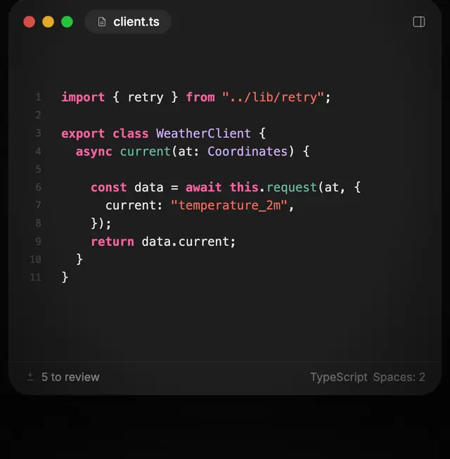

<p align="center">
  <picture>
    <source media="(prefers-color-scheme: dark)" srcset="docs/images/logo-dark.svg">
    
  </picture>
</p>

<h1 align="center">Orbit</h1>

<p align="center">
  <b>The Mac IDE for AI coding agents.</b><br>
  Claude Code, Codex or any ACP agent writes the code. You review it right in the editor.
</p>

<p align="center">
  <a href="https://orbit.mogilnikov.dev"><b>Download for macOS</b></a> ·
  <a href="https://orbit.mogilnikov.dev">Website</a> ·
  <a href="https://orbit.mogilnikov.dev/numbers">The numbers</a> ·
  <a href="docs/roadmap.md">Roadmap</a>
</p>

<p align="center">
  <a href="https://github.com/mikhailmogilnikov/orbit/releases/latest"></a>
  <a href="https://github.com/mikhailmogilnikov/orbit/actions/workflows/ci.yml"></a>
  <a href="LICENSE"></a>
  
</p>

<picture>
  <source media="(prefers-color-scheme: dark)" srcset="docs/images/screenshot-dark.webp">
  
</picture>

Orbit is built with SwiftUI and AppKit, not Electron: 37 MB on disk, 68 MB of
memory with a project open, nothing running when you're not. The agents are
the CLIs you already use, signed in with your own account. Free and open source.

## Agents write the code. You decide what stays.



There's no review tab and no diff in a side panel. An agent's changes appear in
the file it changed: green for what it added, red for what it took out, and
Keep or Undo on every block. That holds whether it edited through its own tools
or the shell, because every turn is checkpointed in a shadow git repository.

| Review | Keys |
|---|---|
| Keep / undo a block | <kbd>⌥⌘↩</kbd> / <kbd>⌥⌘⌫</kbd> |
| Next / previous change, across files | <kbd>⌥⌘↓</kbd> / <kbd>⌥⌘↑</kbd> |
| Keep / undo everything | <kbd>⇧⌘↩</kbd> / <kbd>⇧⌘⌫</kbd> |
| A comment for the agent on any lines | <kbd>⌥⌘/</kbd> |
| Ask the agent to rewrite the selection | <kbd>⌘K</kbd> |

Comments wait above the chat and go to the agent as one message. A rewrite
lands as an agent change, to keep or undo like any other.

<br clear="right">

## Any agent, several at once

Claude Code, Codex, Cursor, Gemini, OpenCode, Grok and the rest of the
[ACP registry](https://agentclientprotocol.com) install from **Settings → Agents**
in a click; a JSON file adds any other. Run chats side by side, each in its own
APFS clone of the project if you like. Rewind a chat to an earlier message,
files included, and turn an isolated chat's work into a pull request.

The chat has what the agents offer: streamed replies, thinking, tool cards with
diffs, plans, permission prompts (<kbd>⌘↩</kbd> to allow), slash commands,
`@` for files, and the model, mode and effort pickers each agent reports.

## Light, because it's a Mac app

Measured against Zed, VS Code and Cursor on the same Mac (M3 Pro, macOS 27),
the same small project, medians of three runs. Agents aren't counted: they cost
the same anywhere.

| | **Orbit** | Zed | VS Code | Cursor |
|---|---:|---:|---:|---:|
| On disk | **37 MB** | 270 MB | 946 MB | 1,017 MB |
| Memory, project open | **68 MB** | 158 MB | 885 MB | 2,429 MB |
| Processes | **2** | 2 | 11 | 22 |
| CPU in a quiet 30 s | **0.00 s** | 0.70 s | 3.69 s | 11.75 s |

Zed opens its first window faster (407 ms to Orbit's 623 ms). The rest, and
how it's measured, is on [the numbers page](https://orbit.mogilnikov.dev/numbers).

## And the rest of an IDE

- **Editor**: tree-sitter highlighting for every language Zed knows, multiple
  carets (<kbd>⌥</kbd>-click, <kbd>⌘D</kbd>, <kbd>⇧⌘L</kbd>), snippets.
- **Language servers** installed from Mason in a click: completion, hover,
  go to definition, rename, code actions, formatting, problems, call hierarchies.
- **Open Quickly** (<kbd>⌘P</kbd>), **Find and Replace in Project** (<kbd>⇧⌘F</kbd>),
  **Command palette** (<kbd>⇧⌘P</kbd>) with every command any plugin registers.
- **Terminal** under the editor (<kbd>⌃`</kbd>): your login shell in the project.
- **Source Control**: stage, commit, branches, stash, history, blame; ✨ writes
  the commit message with your agent.
- **Zed's themes**: color themes, icon themes and snippets load unchanged.
- **Settings** laid out like the Mac's, searchable by option. Updates itself
  through Sparkle.

## Everything is a plugin

The explorer, the editor, the review and the agents are each a plugin on the
same public API, and Settings turns any of them off. An extension is a folder
of themes, icon themes, snippets, agents, language servers or tasks:
[write one](docs/extensions.md) and publish it with a pull request to
[orbit-extensions](https://github.com/mikhailmogilnikov/orbit-extensions); it
shows up in **Settings → Extensions** for everyone.

## Install

Orbit runs on Macs with Apple silicon, macOS 26 (Tahoe) or later.

1. Download it from [orbit.mogilnikov.dev](https://orbit.mogilnikov.dev) (or
   `Orbit-<version>.zip` from [Releases](https://github.com/mikhailmogilnikov/orbit/releases)),
   unzip it and move `Orbit.app` to Applications.
2. Builds aren't notarized yet, so macOS stops the first launch: open Orbit
   once, then click **Open Anyway** in **System Settings → Privacy & Security**.
   Updates after that install by themselves.
3. The welcome tour installs your agents; each signs in the way it does in a
   terminal.

Orbit is its author's daily driver: usable, moving fast, with rough edges.
The [roadmap](docs/roadmap.md) says plainly what's done and what's missing
(no debugger yet, for one).

## Build from source

You'll need Xcode 26, [XcodeGen](https://github.com/yonaskolb/XcodeGen)
(`brew install xcodegen`) and Xcode's Metal Toolchain
(`xcodebuild -downloadComponent MetalToolchain`).

```bash
git clone https://github.com/mikhailmogilnikov/orbit.git
cd orbit
make run     # generates the Xcode project, builds and opens Orbit.app
make test    # unit tests of the OrbitKit package
```

`Orbit.xcodeproj` is generated from `project.yml`; edit that, not the project.
More commands are in the [Makefile](Makefile).

## Documentation

- [Product](docs/product.md): principles and UX decisions
- [Architecture](docs/architecture.md): modules, plugin model, ACP, review pipeline
- [Decisions](docs/decisions.md): why things are the way they are
- [Extensions](docs/extensions.md): writing themes, icon themes and extension packages
- [Releasing](docs/releasing.md): builds, updates, GitHub Releases

## Contributing

Bug reports, ideas and pull requests are welcome; read
[CONTRIBUTING.md](CONTRIBUTING.md) first. Security issues: see
[SECURITY.md](SECURITY.md).

## License

Orbit is licensed under the [GNU General Public License v3.0](LICENSE).
It uses [STTextView](https://github.com/krzyzanowskim/STTextView) (GPL-3.0),
[SwiftTerm](https://github.com/migueldeicaza/SwiftTerm) (MIT),
[SwiftTreeSitter](https://github.com/ChimeHQ/SwiftTreeSitter) (BSD-3-Clause)
and [Sparkle](https://sparkle-project.org) (MIT); their licenses are in
**About Orbit**.
