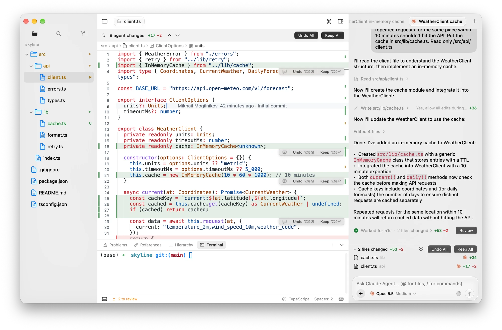

# Orbit

[](https://github.com/mikhailmogilnikov/orbit/actions/workflows/ci.yml)
[](LICENSE)


A native macOS IDE for AI coding agents — Claude Code, Codex and any other
[ACP](https://agentclientprotocol.com) agent. Think "Cursor in IDE mode", built
with SwiftUI and AppKit instead of Electron: light, fast, and at home on macOS.

**Agents write the code. You decide what stays.** Every change an agent makes
shows up inline in the editor — green added lines, red ghost lines for what was
removed — with Keep / Undo per block, whether the agent edited through its own
tools or the shell.

<picture>
  <source media="(prefers-color-scheme: dark)" srcset="docs/images/screenshot-dark.webp">
  
</picture>

> Orbit is built first of all as its author's daily driver. It's usable, moving
> fast, and has rough edges; see the [roadmap](docs/roadmap.md).

## Features

- **Agents over ACP**: Claude Code, Codex, Cursor, Gemini, OpenCode and more,
  installed from the ACP registry; parallel sessions, streaming transcript,
  tool cards with diffs, plans, permission prompts, model / mode / effort pickers.
- **Inline review**: shadow-git checkpoints track every agent turn; review in
  the editor, walk changes across files, keep or undo all at once. Isolated
  sessions work in an APFS clone of the project.
- **Editor**: tree-sitter highlighting for Zed's languages, multi-caret editing,
  snippets, language servers installed from Mason (completion, hover, go to
  definition, rename, code actions, formatting, problems, call hierarchies).
- **Project tools**: Open Quickly (⌘P), Find and Replace in Project, an
  integrated terminal, Source Control (stage, commit, branches, stash, history,
  blame, AI commit messages).
- **Extensions**: Zed color themes, icon themes and snippets load unchanged;
  one Extensions page for agents, language servers, themes and built-in features.
- **Everything is a plugin**: explorer, editor, review, agents and the rest are
  plugins on the same public API.

## Requirements

- macOS 26 (Tahoe) or later
- To build: Xcode 26, [XcodeGen](https://github.com/yonaskolb/XcodeGen)
  (`brew install xcodegen`) and Xcode's Metal Toolchain
  (`xcodebuild -downloadComponent MetalToolchain`)

## Install

Download `Orbit-<version>.zip` from
[Releases](https://github.com/mikhailmogilnikov/orbit/releases), unzip it and
move `Orbit.app` to Applications. Builds aren't notarized yet, so the first
launch needs right-click → **Open**. Orbit updates itself after that
(Sparkle).

Agents run as the CLIs they are: install them from **Settings → Agents** and
sign in the way each one asks.

## Build from source

```bash
git clone https://github.com/mikhailmogilnikov/orbit.git
cd orbit
make run     # generates the Xcode project, builds and opens Orbit.app
make test    # unit tests of the OrbitKit package
```

`Orbit.xcodeproj` is generated from `project.yml`; edit that, not the project.
More commands are in the [Makefile](Makefile).

## Documentation

- [Product](docs/product.md) — principles and UX decisions
- [Architecture](docs/architecture.md) — modules, plugin model, ACP, review pipeline
- [Decisions](docs/decisions.md) — why things are the way they are
- [Extensions](docs/extensions.md) — writing themes, icon themes and extension packages
- [Releasing](docs/releasing.md) — builds, updates, GitHub Releases

## Contributing

Bug reports, ideas and pull requests are welcome — read
[CONTRIBUTING.md](CONTRIBUTING.md) first. Security issues: see
[SECURITY.md](SECURITY.md).

## License

Orbit is licensed under the [GNU General Public License v3.0](LICENSE).
It uses [STTextView](https://github.com/krzyzanowskim/STTextView) (GPL-3.0),
[SwiftTerm](https://github.com/migueldeicaza/SwiftTerm) (MIT),
[SwiftTreeSitter](https://github.com/ChimeHQ/SwiftTreeSitter) (BSD-3-Clause)
and [Sparkle](https://sparkle-project.org) (MIT); their licenses are in
**About Orbit**.
